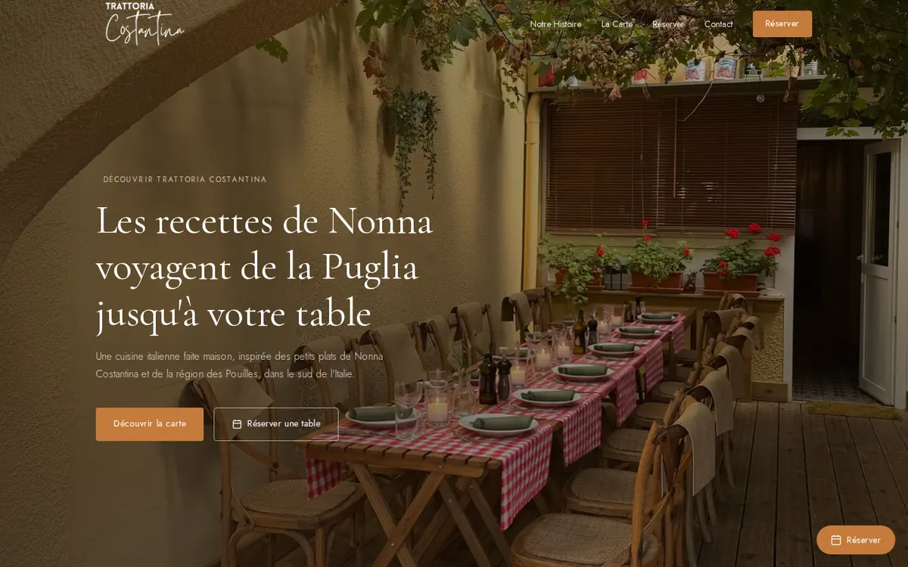
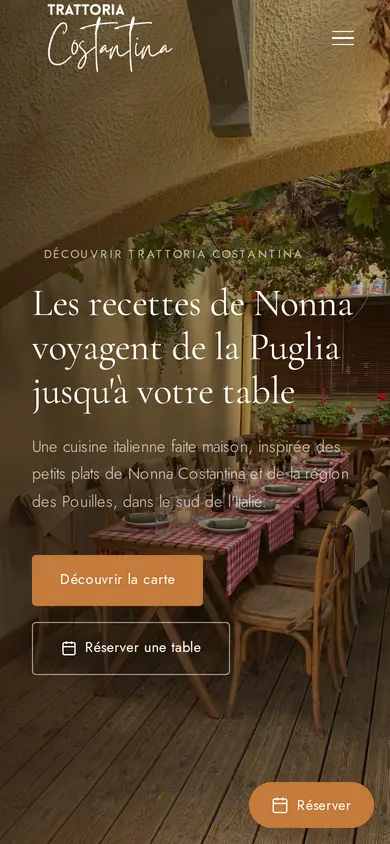
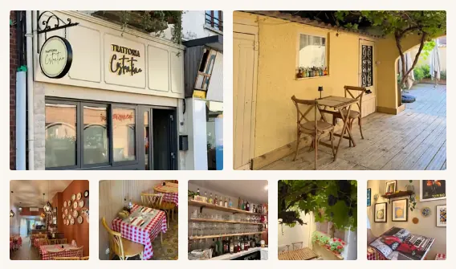

# Homepage image transfer

Phase 1 base: `f8d9ea1`. Linear lookup returned `linear_not_connected`; no issue ID is available.

The hero component and every existing image file are unchanged. The five small gallery thumbnails gain 160×213 and 240×320 portrait variants in AVIF/WebP. `Picture` already builds its srcset from the manifest, so no generic component changes are needed. Existing sizes, alt text, geometry, source order, large thumbnails and lightbox behavior remain intact. Large 4:3 thumbnails crop 3:4 sources with `object-fit: cover`; preserve their existing selections and detail rather than reasoning from width × DPR alone.

Original source filenames were searched for in the accessible project/report locations but were not found. Only the new small variants are derived from the existing 1280px WebP files (not from the smaller AVIF thumbnails). Existing 400/800/1280 files are never rewritten by this command:

```sh
npm ci --ignore-scripts
node scripts/optimize-images.mjs --small-only
```

The config records `smallSource` and `smallWidths`. This mode updates only those widths and their manifest entries, retaining other entries. It decodes the checked-in WebP, resizes with Lanczos3 and uses the existing encoders (AVIF quality 50, WebP quality 68); metadata is stripped. It does introduce a lossy generation for these new thumbnails only. Running it twice reproduced the same bytes using the locked Sharp version. The full generator with `--source <original-photos-directory>` still generates from originals, including the new widths; it is intentionally **not** the command for reproducing these derived files or preserving the existing asset bytes.

`FamilleImage` reserves the existing `.famille-bg` inside the fixed-height section (560px desktop, 480px mobile). It mounts the unchanged lazy picture when IntersectionObserver reaches a 400px prefetch margin. The observer disconnects after the first intersection and on unmount. A server-rendered `<noscript>` picture works without JavaScript; a scheduled mount retains native lazy loading when IntersectionObserver is absent. The reservation CTA also needs a capability guard: its existing unconditional observer otherwise crashes the whole homepage in that fallback scenario. The hero remains server-rendered, eager/high, independent of this enhancement.

## Checks without a database

Use Node 24 and the existing lockfile. Do not invoke the ordinary Playwright config for this audit: that config loads local env and has database setup/mutation fixtures.

```sh
npm run lint
npm run typecheck
npm test
npm run build
npm run start -- -H 127.0.0.1 -p 3187
# In another shell, against the running production build:
npx --no-install playwright test --config playwright.images.config.ts
```

The image-specific config has no webServer, env loading or global setup. It uses Chromium for both desktop 1440×900 DPR1 and emulated iPhone 12 390×844 DPR3. The tests use fresh contexts, verify actual request/source selection, initial Famille deferral and loading on scroll, reserved geometry, both fallbacks, hero SSR/eager/high, unchanged large thumbnail selection, and lightbox loading on demand without requiring Git history. Optional audit invariance is separate: `node scripts/check-image-invariance.mjs f8d9ea1` compares all pre-existing image files and Hero.tsx when that base object is available. Browser tests work in shallow checkouts and source archives. Test artifacts use `join(tmpdir(), 'trattoria-image-tests')`, respecting `TMPDIR`. No DB is needed; the menu's unavailable state is expected. Physical Safari and production database-backed menu photos are outside this audit.

For an environment-free build, archive/copy the checkout into a temporary directory excluding `.env*`, `.git`, `.next` and `node_modules`, then install the existing lockfile there. Do not use a node_modules symlink outside the build root: Turbopack rejects it. No production configuration or secrets are required.

## Repeating the browser measurement

The portable script is checked in at [scripts/measure-home-images.mjs](../scripts/measure-home-images.mjs). It uses dependencies from `--source` (defaults to this checkout), requires a **new** output directory via `--out`, and accepts `--baseURL`. It does not read env files. The output directory's parent must exist; the script creates the final directory and refuses to overwrite an existing baseline.

With the env-free production build running on port 3187:

```sh
node scripts/measure-home-images.mjs \
  --source /absolute/path/to/built/checkout \
  --out /absolute/path/to/new-output-directory \
  --baseURL http://127.0.0.1:3187
```

For temporary artifacts, choose a new directory under your configured `TMPDIR`, or use an ignored repo-relative directory (for example `test-results/image-audit`). `--source` points to the checkout containing the existing lockfile-installed Playwright and Sharp; it need not contain Git history. The app under test runs separately at `--baseURL`.

Historical before/after evidence used the original external `before/measure.cjs`. The checked-in version changes only argument/dependency/output setup; the measurement loop and JSON schema are unchanged, and historical results have not been replaced. Each device gets a fresh browser context with normal, initially empty HTTP cache. Network and CPU are unthrottled on localhost. It waits for networkidle plus 1500ms before the initial snapshot; scrolls progressively by 70% viewport every 350ms; waits 1500ms; takes a full-page screenshot; then opens all seven lightboxes separately with cache retained. JSON records actual URLs, CDP transfer bytes (including response overhead), response-body bytes, decoded file dimensions, rendered boxes, sizes, priorities, loading, cache headers and computed CSS images. Screenshots and full baselines belong outside git. The live reservation iframe performs read-only availability requests; no form or booking is submitted.

Evidence directory: `/home/nora/jeff-workspace/reports/2026-10-28-trattoria-images/`, with `before/` and `after/` JSON, initial/full-page screenshots and command logs. No CSS/background network images or hidden duplicate/lightbox images were found in phase 1, including the supplemental iframe scan.

## Before/after evidence

Actual image transfer bytes, including HTTP response overhead; the original unchanged measurement script and cold-cache conditions described above. Full page is cumulative; scroll and lightboxes are additional.

| Device | Initial before → after | Scroll additional before → after | Full page before → after | Seven lightboxes additional before → after |
|---|---:|---:|---:|---:|
| desktop | 250,553 → 196,304 | 146,355 → 130,298 | 396,908 → 326,602 | 435,223 → 435,223 |
| mobile | 334,452 → 273,647 | 482,714 → 491,715 | 817,166 → 765,362 | 555,076 → 555,076 |

Desktop full-page savings: 70,306 bytes (17.7%); mobile: 51,804 bytes (6.3%). Initial savings: 54,249 bytes (21.7%) desktop and 60,805 bytes (18.2%) mobile, from deferring Famille. Scroll-only transfer increases on mobile because Famille moves into that phase; cumulative full-page transfer decreases. The five small thumbnails now select 160px on desktop and 240px on mobile, transferring 24,402 and 42,904 bytes respectively versus 94,708 bytes before. Large thumbnails still select 400px desktop and 1280px mobile; all existing files remain byte-identical. Lightbox additional requests remain seven desktop / five mobile (the two large mobile sources are reused).

Hero selections and image file SHA-256 are identical before/after:

- desktop: `/images/hero/1920.avif`, 168,378 transfer bytes; SHA-256 `3c0b11a3229c7b801b35e1f7632508d32d4be91e5149bd6471ed5179760e7130`.
- mobile: `/images/hero-portrait/1280.avif`, 212,455 transfer bytes; SHA-256 `8dfcf713fd0e78f0a2fd6e0dd21a94beb5c727e81227b26e44aee79f69f8afb4`.

Pixel comparison used original lossless PNGs, decoded to raw RGBA, over the entire initial viewport (hero plus navigation, text and CTA). Desktop 1440×900: **0 / 1,296,000 pixels changed**. Mobile DPR3 1170×2532: **0 / 2,962,440 pixels changed**. Exact raw pixel hashes, selected URLs and source image hashes are recorded externally in `after/hero-pixel-comparison.json`, `after/comparison.json` and `after/asset-invariance.json` (87 existing files unchanged).

The captures below are real after screenshots converted with the existing Sharp dependency for review display; they are resized WebP previews, not the files used for pixel comparison. Original initial/full-page/gallery PNGs remain externally under `after/`. Conversion is reproducible with external `after/visual-evidence.cjs <repo>/docs/image-performance-evidence`. All four previews total about 316 KB.

| Desktop after | Mobile after |
|---|---|
|  |  |
|  |  |

Validation: lint and typecheck passed; 229 unit tests across 16 files passed; env-free production build passed; 8 focused Playwright cases passed. Small-only generation reproduced all 20 new files plus manifest byte-identically. Public test config has no DB setup/mutation. No env, auth, DB, CI, production config, package/lockfile or existing hero/image asset changes. Browser binary and build tooling troubleshooting outputs stay in the external evidence directory. No PR published; stop for independent Claude review.


Pre-review portability follow-up: the ordinary focused suite now has six browser cases, with the former twice-run Git-history assertion moved to the explicit standalone invariance command. The original implementation validation above (eight cases including those two invariance runs) remains the historical result.

Portability validation: lint and typecheck passed; all six browser cases passed both in the working checkout and from an env-free source archive with no `.git` directory. A custom `TMPDIR` placed Playwright's `.last-run.json` under `<TMPDIR>/trattoria-image-tests/`. The explicit invariance command passed for all 87 existing files. A separate portable measurement validation is saved under external `after/portable-validation/`; accepted `before/` and `after/` baselines were not overwritten.

The portable validation reproduced the accepted after run exactly for both devices: image URLs, phases, transfer/body bytes and file dimensions all matched (`after/portable-comparison.json`), with no page JavaScript errors. The measurement loop itself was checked byte-for-byte against the historical script.
