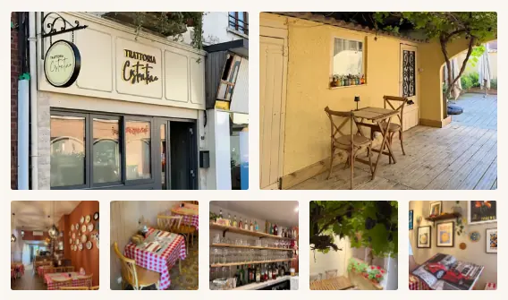
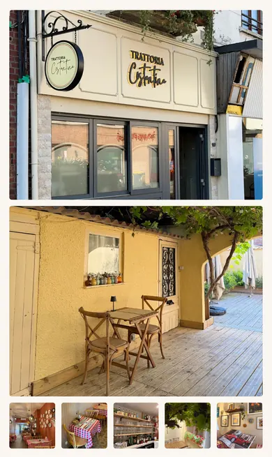

# Homepage image transfer

Baseline: `f8d9ea1`, production build, desktop 1440×900 DPR1 and emulated iPhone 12 390×844 DPR3 in Chromium. No production environment or database is required; database-backed menu photos are absent in this baseline. Physical iOS Safari is outside these measurements.

## Image selection and loading

The hero component, source images, responsive selections and eager/high priority are unchanged. All pre-existing image files are byte-identical to the baseline.

Five small gallery thumbnails gain 160×213 and 240×320 AVIF/WebP variants. Existing sizes, alt text, geometry and source order remain intact. Modern browsers select 160px on desktop and 240px on mobile. Large thumbnails retain 400px desktop / 1280px mobile; lightboxes retain 800px desktop / 1280px mobile. Gallery plain `src` selects the first variant at least 800px wide, preserving the previous fallback on clients without picture/srcset support. Other image fallbacks are unchanged.

Large 4:3 thumbnails crop 3:4 sources with `object-fit: cover`; their existing detail and crops are preserved. Width × DPR alone is not a reason to reduce those sources.

`FamilleImage` reserves the existing fixed-height section and mounts its lazy picture within a 400px observer margin. Its single dark overlay is always rendered, including before picture mounting. A server-rendered `<noscript>` picture supports JavaScript-disabled browsers; a scheduled mount retains native lazy loading without IntersectionObserver. The reservation CTA has a capability guard because its pre-existing unconditional observer crashed the homepage when that API was absent.

## Reproducing the new assets

Run commands from the repository root with Node 24 and the existing lockfile:

```sh
npm ci --ignore-scripts
node scripts/optimize-images.mjs --small-only
```

Original gallery photos were unavailable. Only the new small variants derive from the checked-in 1280px WebP files; existing 400/800/1280 files are not rewritten. The config records `smallSource` and `smallWidths`. Generation decodes that source, resizes with Lanczos3, strips metadata and uses the existing AVIF quality 50 / WebP quality 68 encoders. This introduces a lossy generation only for the new thumbnails. All 20 files and the manifest reproduce byte-identically with the locked Sharp version.

Full generation with `--source <original-photos-directory>` instead uses originals, including for small widths. It does not reproduce the derived thumbnail bytes or preserve existing assets.

## Verification

Build and run from an env-free temporary checkout, excluding `.env*`, `.git`, `.next` and `node_modules`, then install its existing lockfile. Dependencies must reside inside that build root; Turbopack rejects an external node_modules symlink. Temporary artifacts should be under the configured `TMPDIR`.

```sh
npm run lint
npm run typecheck
npm test
npm run build
npm run start -- -H 127.0.0.1 -p 3187
# In another shell against that production server:
npx --no-install playwright test --config playwright.images.config.ts
# Optional, from the repository root when the base Git object is available:
node scripts/check-image-invariance.mjs f8d9ea1
```

The image-specific Playwright config has no environment loading, database setup or mutation fixtures. Do not use the ordinary DB-backed test config for this audit. Artifacts use `join(tmpdir(), 'trattoria-image-tests')`. The six browser cases work without Git history and cover network selection, Famille deferral/scroll loading, actual geometry and overlay coverage in all three modes, plain-src lightbox fallback, gallery bounds, and server-rendered eager/high hero behavior.

Lint, typecheck, 229 unit tests, the production build, all six browser cases and invariance of 87 existing image/hero files passed.

## Repeating the measurement

The checked-in [measurement script](../scripts/measure-home-images.mjs) accepts portable arguments and never loads env files. `--source` defaults to this checkout and resolves its existing Playwright/Sharp dependencies. `--out` must be a new directory with an existing parent; an existing output directory is rejected.

```sh
node scripts/measure-home-images.mjs \
  --source /absolute/path/to/built/checkout \
  --out "$TMPDIR/trattoria-image-audit-after" \
  --baseURL http://127.0.0.1:3187
```

Use a fresh output name for each run. Each device gets a fresh context with enabled, initially empty HTTP cache, unthrottled localhost network and no CPU throttle. The runner waits for networkidle plus 1500ms, captures the initial viewport, scrolls by 70% viewport every 350ms, waits 1500ms, captures the full page, then opens all seven lightboxes separately with cache retained. JSON records URLs, transfer/body bytes, image dimensions, rendered boxes, priorities, loading, cache headers and computed CSS images. The reservation iframe makes read-only availability requests; no booking/form is submitted.

The measurement loop is unchanged from the baseline runner. Raw PNGs, JSON and detailed geometry remain in the separately supplied evidence bundle, under `before/`, `after/` and `quality/`; these large artifacts are not committed. `quality/measurement/` is the latest measurement. Its image URL/phase/dimension/byte ledger exactly matches the earlier after run, with no page JavaScript errors.

## Results

Image transfer bytes include HTTP response overhead. Scroll and lightbox columns are additional; full page is cumulative. The final build was remeasured: transfer and body bytes remain unchanged after the overlay/fallback corrections.

| Device | Initial before → after | Scroll additional before → after | Full page before → after | Seven lightboxes additional before → after |
|---|---:|---:|---:|---:|
| Desktop | 250,553 → 196,304 | 146,355 → 130,298 | 396,908 → 326,602 | 435,223 → 435,223 |
| Mobile | 334,452 → 273,647 | 482,714 → 491,715 | 817,166 → 765,362 | 555,076 → 555,076 |

Full-page savings: 70,306 bytes (17.7%) desktop and 51,804 bytes (6.3%) mobile. Initial savings from Famille deferral: 54,249 bytes (21.7%) and 60,805 bytes (18.2%). Mobile scroll-only bytes increase because Famille moves into that phase. The five small thumbnails transfer 24,402 / 42,904 bytes, versus 94,708 before. Lightboxes add seven desktop / five mobile requests because the two large mobile sources are reused.

Hero selected files and SHA-256 are unchanged:

- Desktop: `/images/hero/1920.avif`, `3c0b11a3229c7b801b35e1f7632508d32d4be91e5149bd6471ed5179760e7130`.
- Mobile: `/images/hero-portrait/1280.avif`, `8dfcf713fd0e78f0a2fd6e0dd21a94beb5c727e81227b26e44aee79f69f8afb4`.

The entire initial viewport is pixel-identical to baseline: 0 changed pixels out of 1,296,000 desktop and 2,962,440 mobile DPR3 pixels, including hero, navigation, text and CTA.

### Famille and gallery geometry

Normal, no-JavaScript and no-IntersectionObserver captures measure identical section/image/background/overlay rectangles: 1440×560 CSS px desktop and 390×480 mobile. Exactly one overlay uses `rgba(20, 10, 4, 0.5)`, including before the normal picture mounts. No-JS and no-IO section screenshots are pixel-identical to normal on both devices. The six original PNGs are named `<device>-famille-<normal|no-js|no-io>.png` in the external `quality/` bundle; measured rectangles are in `geometry.json`.

Gallery bounds are identical before/after: desktop x=152, width=544, right=696; mobile x=32, width=326, right=358 CSS px. Rightmost thumbnail edges are 695.984 / 357.984, within the gallery and viewport. Gallery scrollWidth equals clientWidth, and document width equals viewport width: no horizontal overflow or layout regression. The earlier tight element captures placed the outer edge at the screenshot boundary; padded captures below show complete thumbnails. Baseline galleries were freshly captured from the original production build with the same viewport/DPR. No gallery CSS changed.

### Lightweight captures

These WebP previews are resized from real lossless QA PNGs. Pixel comparisons use the original external PNGs, not these previews.

| Desktop after | Mobile after |
|---|---|
|  |  |

| Gallery | Desktop | Mobile |
|---|---|---|
| Before |  |  |
| After |  |  |
